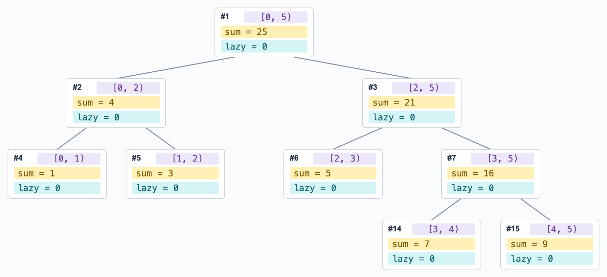

# 线段树

> 为什么需要线段树？

- 如果我们想知道数组 `arr` 的任意区间和 `sum(arr[i:j])`，那么维护 <u>前后缀和</u> 是一个不错的选择 

    => 只需预处理一次、之后所有查询仅需 $O(1)$

    - 但如果数组中的值需要 <u>被修改呢</u> ？此时需要重新计算 **所有** 前后缀和

    - 此外，前后缀和也不能提供对区间 <u>最大/最小值</u> 的快速查询支持

- 线段树（Segment Tree）就是为维护这类 <u>需要动态修改的区间信息</u> 设计的，可以在 $O(\log{N})$ 内实现单点修改、单点查询、区间修改，以及区间查询

本文仅介绍最基本的线段树实现（递归建树 + 懒更新）

<!-- more -->

## 1 长什么样 + feat.

数组 $[1, 3, 5, 7, 9]$ 构建得到的 "区间和" 线段树如下图所示：

- 每个节点存储的信息为：<span style="color:#674093">对应 Range (紫色)</span>、<span style="color:#F9EA97">区间信息 (黄色)</span>、<span style="color:#0D8F9E">Lazy 值 (蓝色)</span>


其中：

- 叶节点对应的区间长度为 1、即存储 **单个元素** 信息

- 非叶节点 $[l,r)$ 拥有两个区间分别为 $[l,m)$ 和 $[m,r)$ 的子节点、并通过聚合两个子节点的信息得到自身值

    为尽可能降低树高、我们需要尽量对半分 => 取 $m = \lfloor (l+r)/2 \rfloor$

    由此保证构建得到的线段树为 <u>平衡二叉树</u>，树高为 $\lceil \log_2{N} \rceil$、令单点操作复杂度为 $O(\log{N})$

## 2 (递归) 建树

- 使用一维数组来存储 ST 树节点。采用标从 1 开始的元素时，满足：$\text{lchild} = 2*i,\ \text{rchild} = 2*i+1$

- 数组长度：当存储长度为 $N$ 的数组信息时，我们需要 $N$ 个 Leaf Node

    最差情况为占用 <u>满二叉树</u>，假设底层有 $N$ 个节点、此时共 $2N - 1$ 个点

    此时，为最右下节点添加一个 $rchild$、其下标为 $2*(2N-1)+1 = 4N - 1$

    因此，我们最多需要一个长 $4N$ 的数组（里面会有一些空值）

```py title="参考实现"
class SegmentTree:

    def __init__(self, nums: list):       
        self.N = len(nums)

        # 初始化数组
        self.tree = [0 for _ in range(4*self.N)]
        """self.lazy = [0 for _ in range(4*self.N)]"""

        self._buildTree(nums, 1, 0, self.N) # 使用从 1 开始的数组元素（方便计算 l/r）

    def _buildTree(self, nums: list, node: int, start: int, end: int):
        """node[node] 对应区间 [l, r)"""
        # Leaf: 区间长度为 1，停止递归
        if start==end+1: 
            self.tree[node] = nums[l]
            return
        
        # 继续下推
        m = (l+r)//2
        self._buildTree(nums, 2*node,   l, m)
        self._buildTree(nums, 2*node+1, m, r)

        # 基于两个子节点计算当前节点值
        self._pullUp(node)

    """基于左右孩子更新父节点 tree[node] 的值（本实现中为 SUM）"""
    def _pullUp(self, node: node): self.tree[node] = self.tree[2*node] + self.tree[2*node+1]
```

## 3 单点查询与修改

- 查询

    - 若查询到 Leaf Node，则流程终止、返回节点值

    - 否则，比较当前节点维护的区间中点 `m = (start+end)//2` 与待查询下标 $idx$ 的大小，以决定向左/右节点查询

- 修改：逻辑与 `查询` 类似，修改要再多一个 Bottom-Up 的 `_pullUp` 操作、从而更新所有祖先节点

    > 有点像后序遍历的操作？先处理两个子节点、然后再处理当前节点

    ```py title="单点更新参考实现"
    def update(self, idx, value):
        """将 nums[idx] 修改为 value"""
        self._update(1, 0, self.N, idx, value)

    def _update(self, node, l, r, idx, value):
        # Leaf：递归终点
        if r==l+1: 
            self.tree[node] = value
            return

        """self._pushDown(node, l, r) # 先 pushDown"""

        # 判断向左/向右查找
        m = (l+r)//2
        if idx < m:
            self._update(2*node,   l, m, idx, value)
        else:
            self._update(2*node+1, m, r, idx, value)

        # 更新当前节点值
        self._pullUp(node)
    ```

## 4 区间操作

### 查询

```text
                     [] 中的值为节点维护的下标闭区间

                                  [0:4]
                                /       \
                            [0,1]      [2:4]
                            /   \      /   \
                          [0]   [1]   [2]  [3,4]
                                           /   \
                                          [3]  [4]
```


- 对于如上图所示的线段树，对区间 `[3:4]` 的查询过程非常明确

    从根节点出发，`[0:4] -> R -> [2:4] -> R -> [3:4]` 即可

- 但对于区间 `[1:3]`，则需要拆分为多路、并对结果进行聚合：

    1. `[0:4] -> L -> [0:1] -> R -> [1]`
    2. `[0:4] -> R -> [2:4] -> L -> [2]`
    3. `[0:4] -> R -> [2:4] -> R -> [3:4] -> R -> [3]`

- 如何拆分？

    查询的过程本质上是将待查询区间 `[l,r]` 拆分为线段树中的若干不相交子区间

    被拆分的节点越少越好，这要求所有拆分得到的子区间均为 `[l,r]` 内的 <u>极大区间</u>（首个被 **完全包含于** `[l,r]` 的节点）

```py title="参考实现"
def query(self, l, r):
    return self._range_query(1, 0, self.N, l, r)

def _range_query(self, node, start, end, l, r):
    # 没有交集
    if r<=start or end<=l:  return 0

    # 递归终点：当前节点被查询区间包裹
    if l<=start and end<=r: return self.tree[node]

    # 下推 + 聚合
    m = (start+end)//2
    return(
        self._range_query(2*node, start, m, l, r) \
        + \
        self._range_query(2*node+1, m, end, l, r)
    )
```

### 修改与懒标记

不同于单点修改，区间修改（例如，将区间内所有元素 `+x`）将 <u>同时影响所有祖先节点+子孙节点</u>

- 如果将其视为 `n` 次单点修改 => 显然十分弱智，每个点自顶向下遍历 + 自底向上更新（还有很多重复的）

- 因此，我们重磅推出 `lazyTag`，用以标记对子孙节点（不包括当前节点）<u>需要进行、但暂未执行</u> 的更新操作（值）

    - 在每次区间修改操作中，我们仅更新 <u>极大区间结点 + 祖先结点</u>

    - 对所有 <u>子孙节点</u> 的操作则推迟到必要时再进行（领导真的查到这个点了）

一次对区间 `[0,5)` 的所有元素执行 `+2` 操作的 `lazyTag` 变化如下图所示：



```py title="参考实现"
    """给 [l,r) 区间增加 delta、记录待下传的 lazy 标记"""
    def _applyLazy(self, node, l, r, delta):   
        self.tree[node] += delta*(r-l) # 和 max/min 操作不一样
        self.lazy[node] += delta
    
    """基于左右孩子更新当前值（SUM）"""
    def _pullUp(self, node): 
        self.tree[node] = self.tree[2*node] + self.tree[2*node+1]

# ---------------------------------------------------------------- #

    def range_update(self, l, r, delta):
        """给 nums[l: r] 的每个元素增加 delta"""
        self._range_update(1, 0, self.N, l, r, delta)

    def _range_update(self, node, start, end, l, r, delta):
        # 没有交集、停止
        if r<=start or end<=l: return

        # 递归终点：更新当前节点、不处理孩子
        if l<=start and end<=r:
            self._applyLazy(node, start, end, delta)
            return

        # 继续下推
        self._pushDown(node, start, end)

        m = (start + end) // 2
        self._range_update(2 * node, start, m, l, r, delta)
        self._range_update(2 * node + 1, m, end, l, r, delta)

        self._pullUp(node)
```

!!!comment "添加 `lazyTag` 后的 单点/区间 修改操作均符合以下流程"
    1. 判断是否终止

    2. 下推

        1. pushDown: 传递 lazy 值
        2. 向左 / 向右 递归遍历      <= Query 操作只有这一步
        3. pullUp:   更新祖先节点值
    

## Ref 与 拓展

本文尚且缺少对于 `非递归实现 (zkw 线段树)`、`动态开点` 等技巧，以及在 `区间乘积加法混合操作` 情况下 lazyTag 变化情况的讨论。可参考以下 blog：

[1] [线段树入门](https://www.luogu.com.cn/article/ukfm03p0), idle_onlooker

[2] [线段树基础](https://oi-wiki.org/ds/seg/), OI Wiki 
